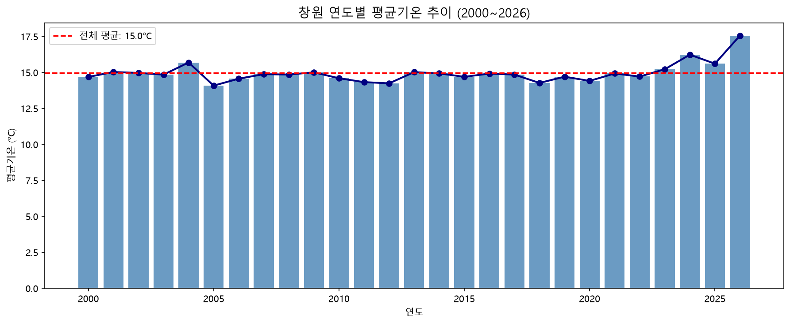
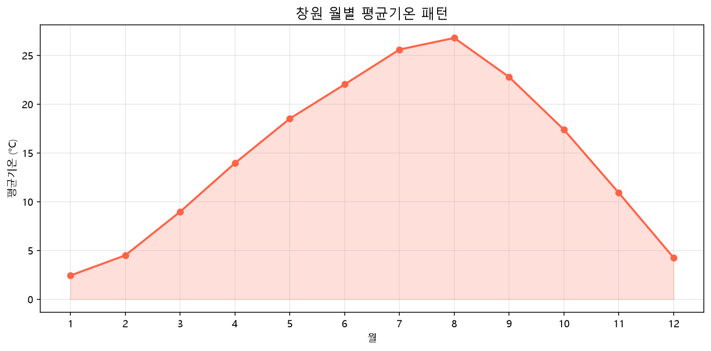
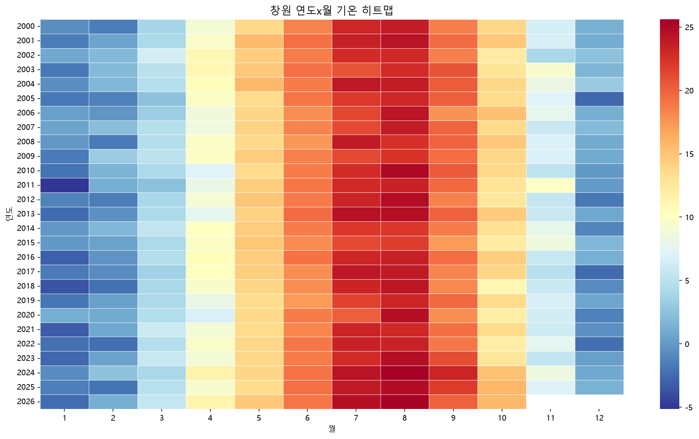
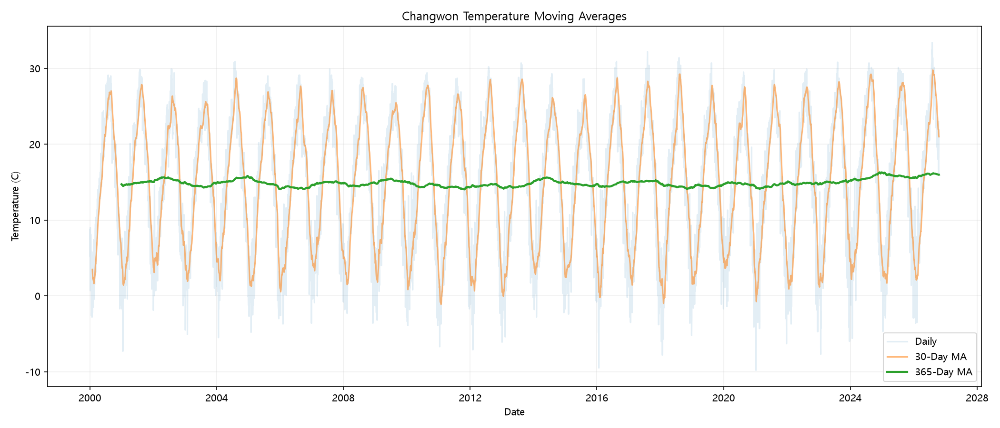
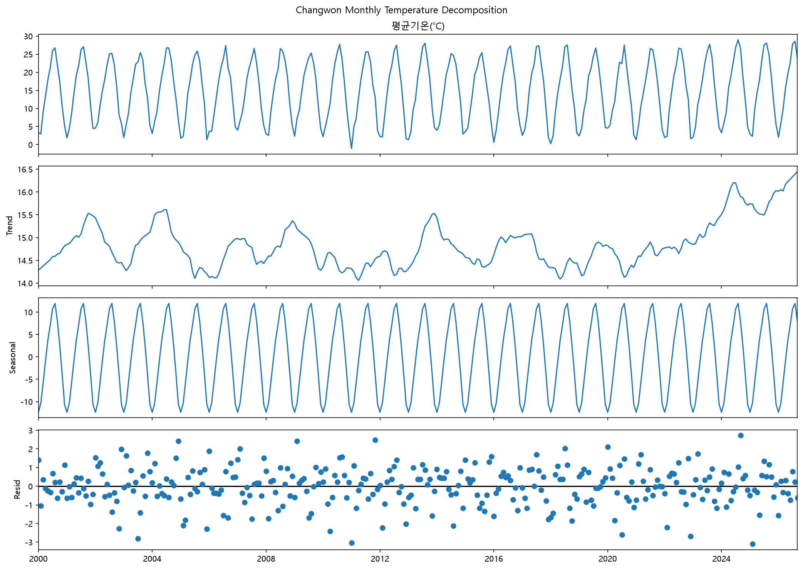
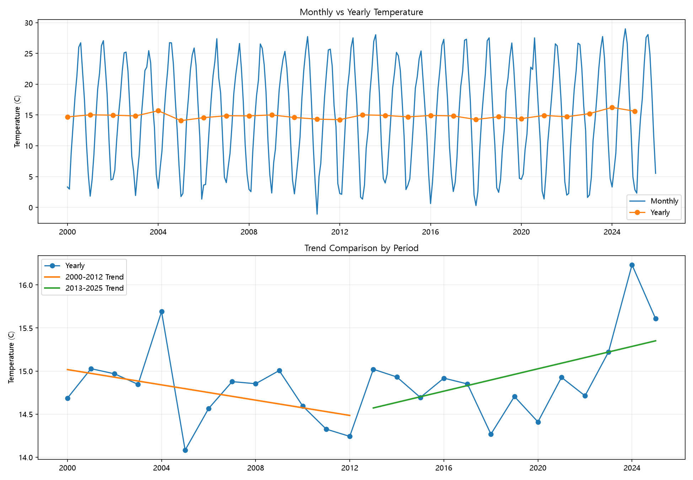

# 창원 기온 시계열 분석 리포트

## 1. 분석 주제 및 선정 이유

- **주제**: 창원시 기온 데이터(2000~2026년) 시계열 분석
- **선정 이유**: 최근 기후변화 이슈가 증가하면서, 실제 지역 단위에서 
  기온 변화가 어떻게 나타나는지 데이터로 확인하고자 함
- **핵심 질문**: 창원은 실제로 더워지고 있는가?

---

## 2. 분석 질문

1. 창원의 연평균 기온은 27년간 상승 추세인가?
2. 월별 기온 패턴(계절성)은 매년 일정한가?
3. 최근 5년(2020~2024)은 이전 기간보다 더 더운가?

---

## 3. 데이터 설명

- **출처**: 기상청 공공데이터포털
- **기간**: 2000년 1월 ~ 2026년 10월
- **데이터 수**: 9,788개 (일별 관측값)
- **주요 컬럼**: 날짜, 평균기온(°C)
- **결측치 처리**: 결측값 제거 후 분석
- **라이선스**: 기상청 공공데이터 (공공누리 1유형)
- **파일명**: `ta_20261019150729.csv`
- **SHA256**: `919EA36AF9DD08C866AD825E8A5692F44E2221A4B860DA03BFCF92CBCAC0C56B`
---

## 4. 분석 결과 및 시각화

### 시각화 1 - 연도별 평균기온 추이


- 2000년~2026년 연평균 기온 변화를 막대그래프로 표현
- **집계 단위 선택 이유**: 단기 노이즈를 제거하고 장기 추세 파악에 유리

### 시각화 2 - 월별 평균기온 패턴


- 1월~12월 월별 평균기온을 시각화
- **집계 단위 선택 이유**: 계절성 패턴 확인에 적합

### 시각화 3 - 연도×월 히트맵


- 연도와 월을 교차해 기온 분포를 색상으로 표현
- 특정 연도·월의 이상 고온/저온 구간 식별 가능

---

## 5. 인사이트

### 인사이트 1 - 장기 기온 상승 추세
- **관찰(Fact)**: 연평균 기온이 2000년 14.686°C에서 2024년 16.233°C로
  2000년 대비 2024년 +1.547°C 차이
- **원인(Why)**: 도시화에 따른 열섬 효과 및 전 지구적 온난화 영향으로 추정.
  단, 창원 산업단지 확장과의 연관성은 추가 검증 필요
- **행동(Action)**: 인근 농촌 지역 기온 데이터와 비교해 도시 열섬 효과
  기여도를 분리 분석 권장

### 인사이트 2 - 여름철 고온 심화
- **관찰(Fact)**: 7~8월 평균기온이 26°C 이상으로 가장 높으며,
  히트맵에서 2018년 이후 여름철 고온 구간(붉은색)이 뚜렷하게 증가
- **원인(Why)**: 2018년 역대급 폭염(전국 최고기온 경신)의 영향으로 추정.
  이후 여름 기온이 구조적으로 높아진 가능성 있음
- **행동(Action)**: 폭염일수(일최고기온 33°C 이상) 별도 집계로
  건강·에너지 정책 시사점 도출 가능


### 인사이트 3 - 겨울철 월별 기온 변화 비교

- **관찰(Fact):** 2000년과 2024년의 겨울철 월평균 기온을 비교한 결과, 1월은 약 0.006℃ 낮아졌고, 2월은 약 3.072℃ 높아졌으며, 12월은 약 0.461℃ 낮아졌다.
- **해석(Why):** 2월에는 뚜렷한 기온 차이가 나타났지만, 1월과 12월은 비슷하거나 낮은 기온을 기록했다. 따라서 두 연도만 비교하여 겨울철 전체의 장기적인 온난화 추세를 단정하기 어렵다.
- **제안(Action):** 여러 해의 겨울철 기온과 난방 에너지 수요 데이터를 추가 분석하여 계절별 변화 특성을 확인할 필요가 있다.


---

## 6. 결론 및 한계점


### 결론

창원의 연평균 기온은 2000년 14.686℃에서 2024년 16.233℃로 나타났으며, 두 연도 간 기온 차이는 약 +1.547℃이다.

2000~2025년 전체 기간의 연평균 기온을 이용한 선형 추세 추정치는 약 +0.147℃/10년으로 계산되었다. 이는 특정 두 연도의 기온 차이와 구분하여 해석해야 한다.

분석 기간을 2000~2012년과 2013~2025년으로 나누었을 때 추세의 방향과 크기가 달라지는 점도 확인되었다. 따라서 특정 연도나 일부 월의 비교 결과만으로 장기적인 기후 변화를 단정하는 것은 적절하지 않다.

본 분석은 창원 지역의 장기 기온 변화와 계절적 특성을 이해하기 위한 기초 자료로 활용할 수 있으며, 기온 변화의 원인을 파악하기 위해서는 추가적인 기상·환경 자료와 통계적 검증이 필요하다.


### 한계점
1. **단일 지점 한계**: 창원 1개 관측소 데이터로 지역 전체를 대표하기 어려움
2. **외부 변수 미반영**: 도시화, 산업화, 토지이용 변화 등 기온에 영향을 주는
   요인을 분석에 포함하지 못함
3. **2026년 데이터 불완전**: 2026년은 10월까지만 포함되어 연간 비교 시 주의 필요

---

## 7. AI 사용 로그

| 작업 | 사용 이유 | 검증 방법 |
|------|----------|----------|
| 데이터 전처리 코드 작성 | pandas 문법 빠른 구현 | 출력값 직접 확인(head/info/describe) |
| 시각화 코드 작성 | matplotlib 옵션 탐색 시간 절감 | 그래프 출력 후 축·레이블 직접 검토 |
| 인사이트 문장 다듬기 | 관찰/원인/행동 형식 구조화 | 수치는 직접 그래프에서 재확인 |
| 결론/한계점 작성 | 누락 항목 점검 | 미션 요구사항과 대조 검토 |

---

## 8. 실행 방법

```bash
# 1. 가상환경 활성화
source venv/bin/activate  # Mac/Linux
venv\Scripts\activate     # Windows

# 2. 의존성 설치
pip install -r requirements.txt

# 3. 노트북 실행
jupyter notebook changwon_analysis.ipynb


## 9. Data Quality and Outlier Handling

### Missing Values
- Total observations: 9,788
- Missing mean temperature: 0
- Missing minimum temperature: 1
- Missing maximum temperature: 1
- Decision: Preserve original data. Handle missing values only when analyzing the affected columns.

### Logical Validation
- Rule: Minimum temperature <= Mean temperature <= Maximum temperature.
- Result: 0 invalid rows among complete observations.
- Decision: No deletion required based on logical consistency.

### Statistical Outliers
- Method: Monthly IQR (Interquartile Range).
- Lower bound: Q1 - 1.5 * IQR.
- Upper bound: Q3 + 1.5 * IQR.
- Result: 75 candidate outliers (approximately 0.77%).
- Decision: Retain all candidate outliers for the current analysis.

### Rationale
Temperature data are seasonal. Extreme observations may reflect real heatwaves or cold spells.
Removing statistically unusual observations without verifying measurement errors could distort long-term climate trends.
Therefore, statistical outliers are flagged but not automatically removed.

## 10. Moving Average Analysis

### Purpose
Identify long-term temperature patterns while reducing short-term fluctuations.

### Methods
- 30-day simple moving average (SMA): smooths short-term daily variation.
- 365-day SMA: reduces annual seasonal fluctuations to reveal longer-term patterns.
- Full windows of 30 and 365 observations were required.
- Original daily observations and statistical outlier candidates were retained.

### Results
- Total daily observations: 9,788
- Valid 30-day SMA values: 9,759
- Valid 365-day SMA values: 9,424
- On 2026-10-18:
  - Daily mean temperature: 21.90 C
  - 30-day SMA: 20.99 C
  - 365-day SMA: 15.96 C



### Interpretation
The daily series shows substantial variation.
The 30-day SMA retains a strong annual seasonal cycle.
The 365-day SMA is smoother and shows a visually higher level
in recent years than in some earlier periods.

These visual observations are not sufficient to establish
a statistically significant warming trend.
A quantitative trend test would be needed for that conclusion.

### Limitations
- Moving averages introduce overlapping observations.
- The first 29 and 364 observations lack full-window SMA values.
- The 2026 calendar year is incomplete.
- Extreme but potentially genuine temperature observations remain included.

## 11. Seasonal Decomposition Analysis

### Purpose
Separate long-term temperature changes, recurring seasonal
patterns, and irregular fluctuations.

### Method
- Source: Changwon daily mean temperature observations.
- Aggregation: Monthly mean temperature (321 months).
- Period: January 2000 through September 2026.
- Model: Additive seasonal decomposition.
- Seasonal period: 12 months.
- Incomplete October 2026 excluded.
- No incomplete or missing months detected.
- Trend endpoints are extrapolated estimates.

### Results



### Interpretation
1. Observed: A strong annual temperature cycle is visible.
2. Trend: The estimated trend fluctuates over time,
   with a noticeable rise in the recent period.
3. Seasonal: A recurring 12-month temperature cycle
   is clearly identified.
4. Residual: Both positive and negative irregular
   deviations remain after decomposition.

### Limitations
- Decomposition does not establish causal relationships.
- Statistical significance of warming was not tested.
- Endpoint trend values are partly extrapolated.
- The additive model assumes a stable seasonal pattern.
- Residual extremes do not automatically indicate errors.

## 12. Period and Aggregation Comparison

### Purpose
Test whether temperature trend interpretation changes
when selecting different analysis periods or time units.

### Method
- Source: Changwon daily mean temperature data.
- Period: 2000-2025, excluding incomplete 2026.
- Aggregation: Monthly and yearly arithmetic means.
- Trend: Linear regression using numpy.polyfit.
- Slope unit: Degrees Celsius per decade.

### Period Comparison

| Period | Trend (C/decade) |
|---|---:|
| 2000-2012 | -0.443 |
| 2013-2025 | +0.649 |
| 2000-2025 | +0.147 |

### Aggregation Comparison

| Metric | Monthly | Yearly |
|---|---:|---:|
| Number of observations | 312 | 26 |
| Standard deviation (C) | 8.323 | 0.467 |

### Visualization



### Interpretation
The estimated trend changes with the selected period.
The 2000-2012 slope is negative, while the
2013-2025 slope is positive.

The full-period slope is smaller than the recent-period
slope. Therefore, conclusions about warming rates are
sensitive to the time interval selected.

Monthly aggregation retains strong seasonal variations.
Yearly aggregation reduces seasonal fluctuations.

This comparison provides a counterexample to interpreting
one selected period as representative of all periods.

### Limitations
- Trend significance and uncertainty were not tested.
- Shorter periods may be sensitive to unusual years.
- Different aggregation units measure different variability.
- These results do not demonstrate causes of warming.

## 13. Data Analysis Pipeline

### Overview
The analysis follows four main stages:
Data Loading -> Data Validation -> Time-Series Analysis -> Visualization.

### Stage 1. Data Loading
- Source: Korea Meteorological Administration.
- File: data/changwon_temp.csv
- Encoding: CP949.
- Header handling: skiprows=7.
- Dataset: 9,788 daily observations.
- Variables: Date, station, mean/minimum/maximum temperature.

### Stage 2. Data Validation and Cleaning
- Converted the date column to datetime.
- Standardized column names.
- Confirmed zero duplicate dates.
- Mean temperature missing values: 0.
- Minimum temperature missing values: 1.
- Maximum temperature missing values: 1.
- Temperature-order logical errors: 0.
- Monthly IQR outlier candidates: 75.
- Outlier candidates were retained because extreme
  temperatures may represent real weather events.
- Original observations were preserved for mean
  temperature analysis.

### Stage 3. Time-Series Analysis
1. Aggregated daily observations into monthly and yearly means.
2. Applied 30-day and 365-day moving averages.
3. Applied additive seasonal decomposition with period=12.
4. Compared linear trends for:
   - 2000-2012
   - 2013-2025
   - 2000-2025
5. Compared monthly and yearly aggregation results.
6. Excluded incomplete periods when full-year
   or full-month comparisons were required.

### Stage 4. Visualization and Interpretation
- images/01_yearly_trend.png
- images/02_monthly_pattern.png
- images/03_heatmap.png
- images/04_moving_average.png
- images/05_seasonal_decomposition.png
- images/06_period_aggregation.png

The figures illustrate long-term temperature patterns,
annual seasonality, statistical decomposition,
and sensitivity to the analysis period.

### Reproducibility
- Main notebook: changwon_analysis.ipynb
- Report: REPORT.md
- Original dataset: data/changwon_temp.csv
- Analysis tools: pandas, numpy, matplotlib,
  seaborn, and statsmodels.

### Important Notes
Statistical outlier detection does not prove data errors.
Linear trend slopes were calculated without significance tests.
The incomplete 2026 calendar year was excluded
from full-year comparisons.
